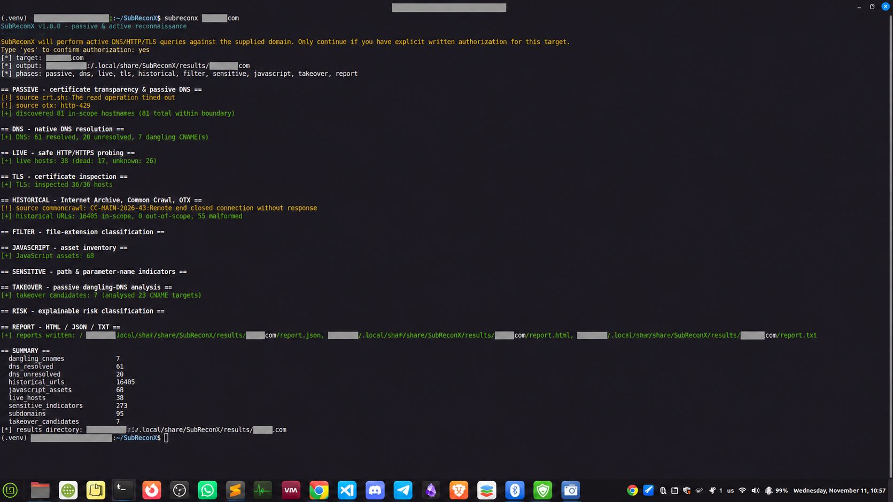

# SubReconX



**SubReconX** is a standalone Python reconnaissance and exposure-intelligence framework for **authorized** Bug Bounty and security testing.

**Full reconnaissance with one command:**

```bash
subreconx example.com
```

Replace `example.com` with a domain you own or are explicitly authorized to assess. Active phases require authorization confirmation.

## Features

- Passive subdomain enumeration
- Native DNS analysis and CNAME inspection
- Safe HTTP/HTTPS live-host probing
- TLS certificate inspection
- Historical URLs from supported public sources
- URL deduplication, filtering, and categorization
- Sensitive path and parameter indicators (with redaction)
- JavaScript asset inventory
- Passive subdomain takeover candidate analysis
- Risk scoring and HTML/JSON/TXT reports
- SQLite storage and resumable scans
- Scope enforcement, SSRF protection, and bounded requests

No third-party **runtime** Python dependencies are required.

## Installation

### Linux (Ubuntu, Debian, Linux Mint)

**1. Install prerequisites**

```bash
sudo apt update
sudo apt install git python3 python3-venv -y
```

**2. Download the project**

```bash
git clone https://github.com/mobadawyx4/SubReconX.git
cd SubReconX
```

**3. Run the installer**

```bash
bash install.sh
```

The installer creates an isolated virtual environment and a `subreconx` launcher in `~/.local/bin`.

**4. Make the command available**

If `subreconx` is not found, run:

```bash
echo 'export PATH="$HOME/.local/bin:$PATH"' >> ~/.bashrc
source ~/.bashrc
```

For Zsh, add the same export line to `~/.zshrc` instead.

**5. Verify**

```bash
subreconx --version
subreconx --help
```

### Windows (PowerShell)

Install **Git for Windows** and **Python 3.10+** first.

**1. Download the project**

```powershell
git clone https://github.com/mobadawyx4/SubReconX.git
cd SubReconX
```

**2. Run the installer**

```powershell
powershell -ExecutionPolicy Bypass -File .\install.ps1
```

**3. Open a new PowerShell window and verify**

```powershell
subreconx --version
```

> The Linux CLI package has been tested. The Windows installer has not yet been verified on a Windows machine.

## Quick Start: Full Recon

Run the default reconnaissance pipeline with **one command**:

```bash
subreconx example.com
```

When you don't specify individual phase flags, the default pipeline runs passive enumeration, DNS, live-host checks, TLS, historical URLs, filtering, sensitive indicators, JavaScript inventory, passive takeover analysis, and reporting.

The CLI asks for authorization confirmation before active checks. **Only scan targets within your permitted scope.**

Optional features such as DNS wordlist discovery and static JavaScript endpoint analysis need their own flags.

## Common Commands

| Goal | Command |
| --- | --- |
| Full reconnaissance | `subreconx example.com` |
| Passive-only mode | `subreconx example.com --passive-only` |
| Passive subdomains | `subreconx example.com --passive` |
| DNS and live hosts | `subreconx example.com --dns --live` |
| Historical URLs | `subreconx example.com --historical` |
| Sensitive indicators | `subreconx example.com --sensitive` |
| JavaScript analysis | `subreconx example.com --javascript --js-analysis` |
| Passive takeover checks | `subreconx example.com --takeover` |
| Reuse saved results and report | `subreconx example.com --report --resume` |
| Show all options | `subreconx --help` |

### Scope-aware scanning

For programs with a defined scope file:

```bash
subreconx example.com --scope-file examples/bugcrowd-scope.json --strict-scope --rate-limit 5
```

The included scope file is an example; replace it with the actual authorized program scope.

## Results and Reports

Results are written under the configured output directory (by default `results/` relative to the working directory):

```text
results/
└── example.com/
    ├── raw/
    ├── organized/
    ├── intelligence/
    └── reports/
        ├── report.html
        ├── report.json
        └── report.txt
```

- **raw/** — Collected data and source metadata
- **organized/** — Cleaned, deduplicated, and categorized assets
- **intelligence/** — Asset intelligence and exposure indicators
- **reports/** — Browser-readable HTML and machine-readable JSON/TXT reports

The default SQLite database is `subreconx.db`, relative to the working directory. Use `--output DIR` and `--db PATH` to choose locations.

## Important Options

| Option | Purpose |
| --- | --- |
| `--passive-only` | Disable active DNS/HTTP/TLS probing |
| `--scope-file FILE` | Load a plain-text or Bug Bounty JSON scope file |
| `--strict-scope` | Require explicit wildcard scope authorization |
| `--rate-limit N` | Limit HTTP requests per second |
| `--concurrency N` | Limit concurrent operations |
| `--timeout N` | Set network timeout |
| `--resume` | Reuse previous stored results |
| `--no-cache` | Disable passive-source cache |
| `--wordlist` | Enable optional DNS wordlist discovery |
| `--wordlist-path FILE` | Use a custom DNS wordlist |
| `--js-analysis` | Enable static JavaScript endpoint analysis |
| `--check-historical-urls` | Enable bounded checks of authorized historical URLs |
| `--max-url-checks N` | Cap historical URL checks |
| `--quiet` / `--verbose` | Control output verbosity |
| `--output DIR` | Choose results directory |
| `--db PATH` | Choose SQLite database file |

Run `subreconx --help` for the complete list.

## Security and Authorization

**Use SubReconX only on domains you own or have explicit permission to test.**

The tool is designed with authorization confirmation, domain-scope validation, private/reserved IP blocking, redirect validation, rate limits, and sensitive-value redaction. Its network checks are read-only; it does not exploit vulnerabilities.

Passive source data may be stale or incomplete. Sensitive paths and takeover candidates are **indicators**, not verified vulnerabilities, and require manual review.

## Requirements

- Python 3.10 or newer (tested with Python 3.12)
- Git for installer-based installation
- Internet connectivity for online reconnaissance
- Linux or Windows

The installer uses a virtual environment. No third-party runtime Python packages are required.

## Testing

From the repository root:

```bash
python3 -m unittest discover -s tests -t . -v
```

The offline test suite currently contains 148 passing tests on the tested Linux environment. This is not a substitute for platform-specific installer testing.

## Project Layout

```text
SubReconX/
├── core/
├── engines/
├── examples/
├── intelligence/
├── protocols/
├── sources/
├── tests/
├── utils/
├── wordlists/
├── config.py
├── main.py
├── install.sh
├── install.ps1
├── pyproject.toml
├── requirements.txt
├── LICENSE
└── README.md
```

## License

MIT License — see [LICENSE](LICENSE).

## Repository

https://github.com/mobadawyx4/SubReconX
